# Shares

## Network Shares

Going back to network shares now that my domain was hybrid joined, I wanted to make it better. Currently I have to type the exact UNC path to find the share on all workstations, otherwise I cannot access it.

On my DC, I mapped the network share `\\WIN-FD0SR0GQS6P\Shares` to drive Z:

**File Explorer → right-click "This PC" → Map Network Drive → select a drive letter, enter the UNC path for the folder and ensure "Reconnect at sign-in" is checked → Finish**

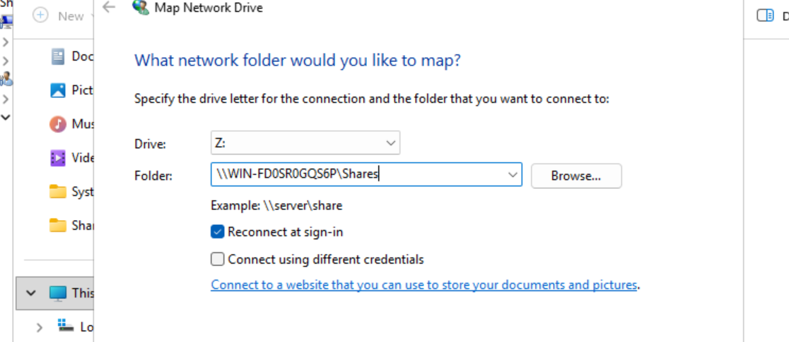

After this it shows every time I go to File Explorer, nested under "This PC".

I shared this with IT staff alone:

**Properties → Sharing → Advanced Sharing → Permissions → added IT Staff and, of course, DCs**

### Pushing the Share to Workstations with Group Policy

To easily push this file share on to my workstations, I created a Group Policy. From `gpmc.msc`, I created a new GPO called **"Share Mapping"** → Edit → **User Configuration → Preferences → Windows Settings → Drive Maps**.

I created a new item that would delete all drives starting at the letter E. This was done as a drive clean-up, so each session starts with old network drive connections deleted.

I then created a second item:

* **Action:** Update
* **Location:** `\\WIN-FD0SR0GQS6P\Shares`
* **Reconnect:** Checked
* **Label as:** Shares

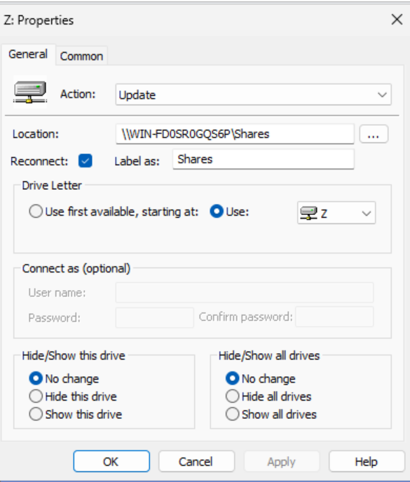

The order of the actions was to first delete all drives, then update drives and connect the network share.

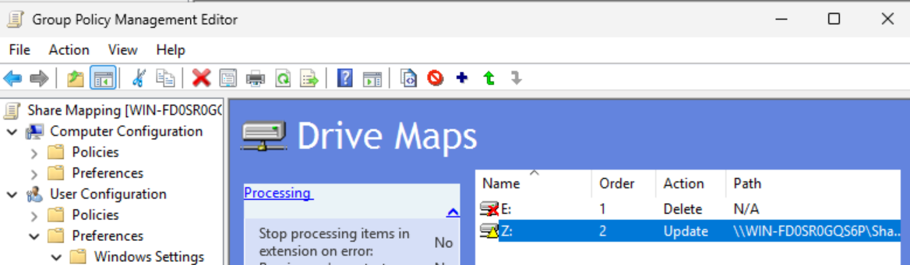

Then I linked the new policy to the IT OU, as I want all IT users to have access to the network shares. The OU for company users would also get a network share eventually; this was just testing for the first implementation.

I ran `gpupdate /force` on the DC. Then I went to check on WS_01 with Kate Libby, the SysAdmin. I checked File Explorer and immediately saw the Shares folder on the Z drive as configured.

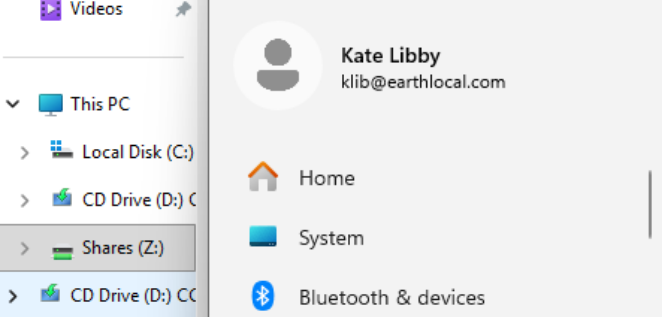

!!! success "Share mapped to IT users via Group Policy"
    Kate Libby (SysAdmin) received the Z drive automatically on WS_01, with no manual mapping.

### A Second Share for All Company Users

I then created another share for all company users, called "Network Shares": `\\WIN-FD0SR0GQS6P\Users\Administrator\Network Shares`. I mapped it to letter Y on the DC and gave the all-users security group read and execute permissions for this share.

I edited the existing Share Mapping group policy and added the new share item as order 3, and linked the GPO to the Company Users OU.

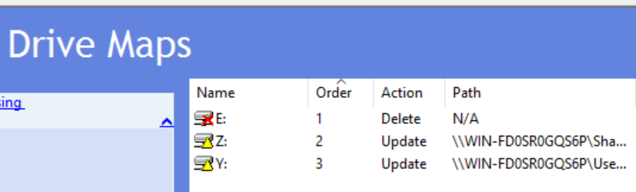

I ran `gpupdate /force` once again, then tested signing out of Kate's session and logging back in. Confirmed.

Then I logged in as a normal company user, Chandler Bing, and confirmed he could see the Network Shares directory. However, he could also see the Shares directory. Due to permissions he could not access it, but I wanted to ensure it could not be seen at all.

## Item-Level Targeting

I did some online searching and looked for the most efficient solution. I discovered a very simple one, a step I could have implemented sooner: **item-level targeting**.

I edited the GPO and, for the IT share on the Z drive:

**Properties → Common tab → Enable item-level targeting → Targeting**

The Targeting Editor popped up. I then followed these steps:

**New Item → Security Group → enter all the security groups for the IT team**

The issue I had with this step was that I had a number of security groups for IT staff, and they all had to be added one by one, whereas non-IT users only have one security group: `EL_General`.

After some looking around in the Targeting Editor, I realised the **Item options** dropdown menu had an option for **"is not"**, meaning I could simply make the target **"is not a member of EL_General"**.

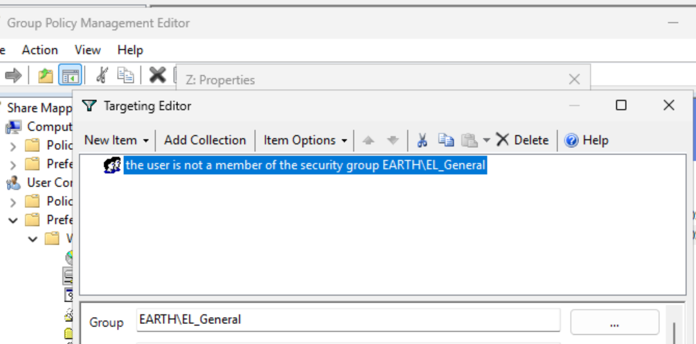

I saved the updated GPO and re-tested with both Kate and Chandler:

* Kate was able to see both drives, as desired.
* Chandler could now only see and access the global share drive.

!!! success "Permissions alone don't hide a drive, item-level targeting does"
    Before targeting, Chandler could see the IT share but not open it. With item-level targeting, the drive is no longer mapped for non-IT users at all.

## SharePoint

In addition to File Explorer network shares, I wanted to create an online share option as well.

With sharing in mind, the first thing I did was define who was allowed to share:

**Admin Center → Settings (left nav) → Org settings → SharePoint → selected "New and existing guests – guests must sign in or provide a verification code."**

I then created a site. (I already had sites due to making groups with Teams enabled; I wanted to create a site from scratch.)

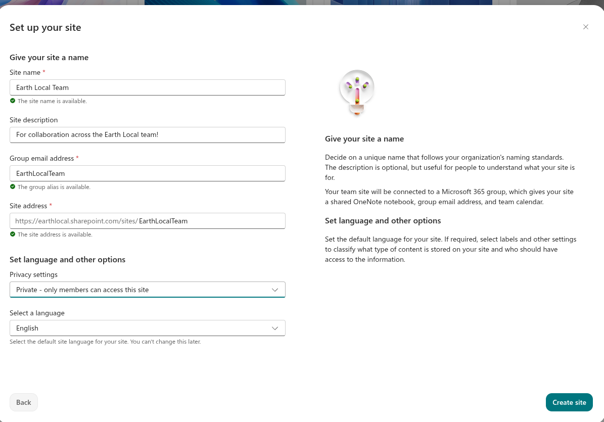

I then wanted to invite all members of my domain. I did this by adding their security groups, as I found this would be quicker and more efficient than adding users one by one:

**SharePoint site → Site Permissions → Advanced permissions settings → Grant Permissions → added all security groups with Edit permissions → Share**

!!! note "Sites shared through security groups don't appear in My Sites"
    When a security group is added to a SharePoint group for a specific site, the site will not appear in the users' My Sites. The User Information List won't show individual users until they have contributed to the site. A workaround is to share the link; users can then mark the site as a "favourite" in SharePoint, and it will also show under "Recent sites".

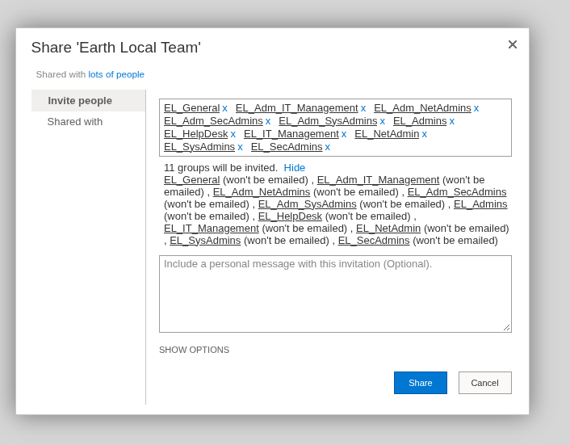

Then I signed in as David Lightman to the site's URL, `https://earthlocal.sharepoint.com/sites/EarthLocalTeam`, to confirm access. This was successful.

### Document Library and Sync

After the creation of a site, a document library is automatically created and can be seen in the navigation bar at the top of the page. As the Admin, I created a document named "First Document.txt". This was seen in David's SharePoint document experience shortly afterwards.

I then clicked the **Sync** option on the document library, which opened OneDrive. As I had not set up OneDrive previously, I had to sign in to Office 365 when prompted, and then a directory was created in File Explorer syncing the library (therefore the SharePoint files).

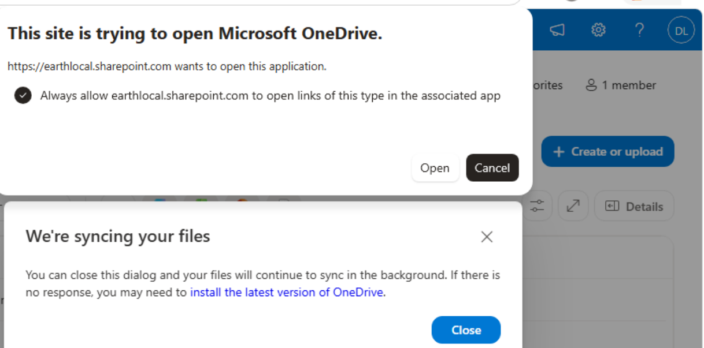

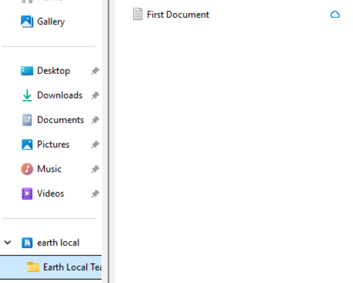

Then I, as David, downloaded a picture and moved it into the local Earth Local directory that OneDrive had created. I went to SharePoint immediately afterwards and could see the image showing there. I checked the admin SharePoint experience and could see it showing there also.

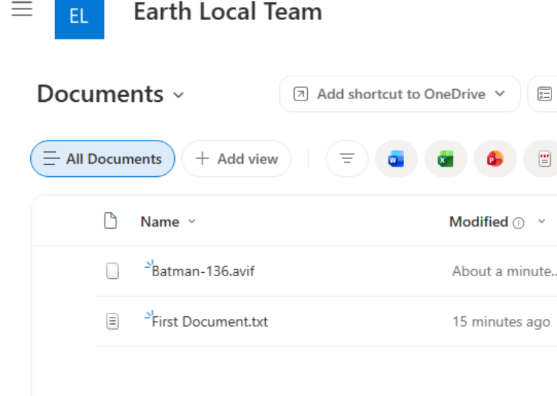

!!! success "Two-way sync between SharePoint and the workstation confirmed"
    A file created online by the admin appeared for David, and a file David added locally appeared in SharePoint and in the admin's view.

---

## Final Validation Summary

| Test | Result |
|---|---|
| Share mapped to Z: for IT users via Group Policy Preferences | ✅ Confirmed (Kate Libby on WS_01) |
| Drive clean-up item runs before the map items (order matters) | ✅ Configured |
| Second share (Y:) mapped to Company Users OU | ✅ Confirmed after `gpupdate /force` and re-login |
| Non-IT user (Chandler Bing) can see the IT share without item-level targeting | ❌ Visible, though not accessible |
| Item-level targeting ("is not a member of EL_General") hides the IT share from non-IT users | ✅ YES |
| IT user sees both drives after targeting | ✅ YES |
| SharePoint external sharing defined (guests must sign in or verify) | ✅ Done |
| SharePoint site created, domain security groups granted Edit | ✅ Done |
| David Lightman can access the site | ✅ YES |
| Document library synced to File Explorer via OneDrive | ✅ YES |
| Changes sync both ways (admin file to David, David's file to SharePoint and admin) | ✅ YES |

---

## Key Takeaways

* **Group Policy Preferences drive maps remove the need to map shares by hand on each workstation.** One GPO pushes the share to every user in the linked OU.
* **Action order in the drive maps item matters.** Deleting old drives first, then updating and connecting the share, gives each session a clean start.
* **Share permissions control access, not visibility.** A user without permission can still see a mapped drive they can't open; item-level targeting is what stops it being mapped at all.
* **"Is not a member of" is simpler than listing groups.** Targeting the non-IT group (`EL_General`) with "is not" avoided adding every IT security group one by one.
* **SharePoint access is quicker through security groups than individual users**, but a site shared that way won't appear in My Sites until users mark it as a favourite or follow the shared link.
* **Syncing a SharePoint library through OneDrive gives users a local folder that stays in step with the site in both directions.**
