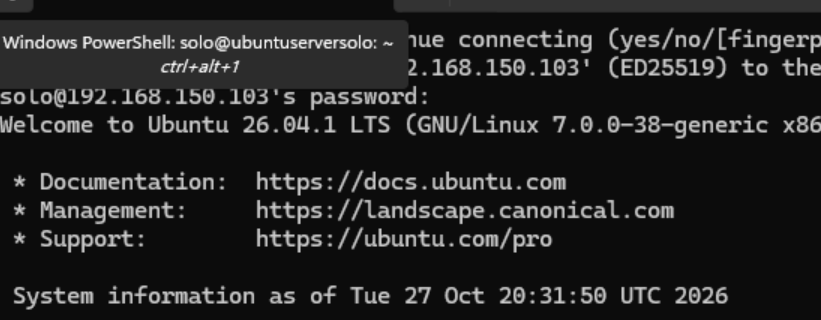
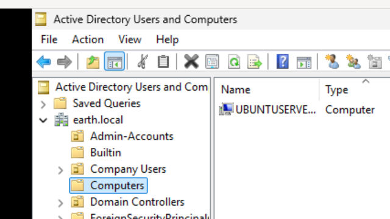

# Joining the Ubuntu Server to Active Directory

With the Ubuntu Server built, I wanted to join it to my `earth.local` domain so that domain accounts could sign in to it, the same way they do on my Windows workstations.

## 1. Connecting over SSH

Next I connected to my server from the Windows DC via SSH.

On the server I ran `ip a` and noted down the IP address for the server. On the DC, I opened PowerShell and ran:

```powershell
ssh server_username@server_ip
```

I was asked if I trusted the host I wanted to connect to, and I said yes. I was then prompted to enter the server password, and then I was in.



## 2. Checking DNS and Time

Then I ran the following commands:

* `resolvectl status` — the DNS server in the output was my DC's IP.
* `resolvectl query earth.local` — I got an error:

    ```text
    earth.local: resolve call failed: No appropriate name servers or networks for name found
    ```

* `timedatectl` — the clock output aligned with my DC and host device.

!!! failure "The domain would not resolve, even with the DC as the DNS server"
    This failed because `.local` is reserved for multicast DNS (mDNS). Linux treats a `.local` name as something to be found on the local network rather than asked of a DNS server, so by default the resolver does not send `.local` lookups to a DNS server at all, unless that domain has been explicitly configured.

To complete testing in my current working session, the non-persistent fix was:

```bash
sudo resolvectl dns <my network interface> <DC-IP>
sudo resolvectl domain <my network interface> '~earth.local'
```

Then I reran `resolvectl query earth.local`, which was successful, resolving the domain name to the DC's IP.

The permanent fix would be to update the netplan config. My plan was to complete the realm join first and make the fix permanent afterwards, but as it turned out, I only completed the realm join after the netplan fix was in place.

## 3. `apt update` Failing

I then wanted to install some packages to complete the realm join process. I first ran `sudo apt update`, and the output had multiple **"Temporary failure resolving"** and **"Failed to fetch"** errors.

An online search led me to askubuntu.com, which provided a solution implying that the cause was DNS resolution. The temporary solution for the "Temporary failure resolving" error was to run:

```bash
echo "nameserver 8.8.8.8" | sudo tee /etc/resolv.conf > /dev/null
```

This enters Google's DNS server into the Ubuntu server's DNS resolver config file, allowing me to resolve domains via `8.8.8.8`, similar to what I did earlier in the homelab with DNS and Cloudflare's DNS servers.

Running `sudo apt update` was successful this time around.

!!! note "In hindsight: a temporary workaround, and the first of two side effects"
    This worked for getting packages, but it was only ever a temporary solution, not a permanent one. Looking back, the most likely reason internet names stopped resolving is the runtime fix in step 2: setting only `~earth.local` on the interface told the resolver to use it for that domain alone, leaving nothing to handle other names. It is the same problem I hit again, and fixed properly, in step 6.

## 4. Installing the Packages

```bash
sudo apt install -y realmd sssd sssd-tools libnss-sss libpam-sss adcli samba-common-bin oddjob oddjob-mkhomedir packagekit
```

Summary of the packages for realm joining:

**Needed for the join itself**

* `realmd`: provides the `realm` command, which discovers the domain and runs the join.
* `adcli`: does the actual work behind `realm join`, such as creating the computer account in AD.
* `samba-common-bin`: Samba helper tools that `realmd` can use during the join.
* `packagekit`: lets `realmd` install any other packages it finds it needs.

**Needed so AD users can sign in afterwards**

* `sssd`: the service that talks to AD for user and group lookups and authentication.
* `sssd-tools`: admin tools for SSSD, such as clearing its cache.
* `libnss-sss`: lets commands like `id` look up domain users through SSSD.
* `libpam-sss`: lets the login process check domain passwords through SSSD.
* `oddjob` and `oddjob-mkhomedir`: create a home folder the first time a domain user logs in.

## 5. Discovering the Domain — "No such realm found"

```bash
realm discover earth.local
```

This failed with **no such realm found**, which was strange given that `resolvectl query earth.local` was working.

!!! note "Resolving the name is not the same as discovering the domain"
    `realm discover` doesn't just look up the domain name. It looks up the SRV records a DC registers in DNS (`_ldap._tcp.earth.local`).

!!! note "In hindsight: the second side effect of the 8.8.8.8 workaround"
    `resolvectl query` asks the system resolver service directly, so it was still using the DC. Other programs read `/etc/resolv.conf`, which I had just pointed at `8.8.8.8`. A public DNS server knows nothing about `earth.local`, which would explain why one command could find the domain while `realm` could not.

### A Fix I Tried That Did Not Work

I tried editing `/etc/systemd/resolved.conf` and adding DNS servers to it:

```ini
DNS=8.8.8.8 1.1.1.1 192.168.150.52
```

This did not resolve the issue.

### Finding the Real State

When I came back to it, `resolvectl status` showed what was going on:

```text
Global
         Protocols: -LLMNR -mDNS -DNSOverTLS DNSSEC=no/unsupported
  resolv.conf mode: stub
Current DNS Server: 8.8.8.8
       DNS Servers: 8.8.8.8 1.1.1.1 192.168.150.52

Link 2 (enp1s0)
    Current Scopes: DNS
         Protocols: +DefaultRoute -LLMNR -mDNS -DNSOverTLS DNSSEC=no/unsupported
Current DNS Server: 192.168.150.52
       DNS Servers: 192.168.150.52
     Default Route: yes
```

Three things stood out:

* **The `~earth.local` routing domain was gone.** There was no `Domains:` line under `enp1s0`, because the runtime setting from step 2 had not survived. Without it, `.local` lookups were once again not being sent to the DC.
* **The `DNS=` line I added had made public servers global DNS servers**, with `8.8.8.8` as the current one. A public DNS server answers "no such domain" for `earth.local`, and listing the DC third did not help.
* **My `/etc/resolv.conf` change had not lasted either.** The output shows `resolv.conf mode: stub`, the default, confirming that edit was temporary.

!!! failure "My workarounds had stacked up"
    Each quick fix solved the error in front of me and left something behind: a runtime setting that disappeared, and public DNS servers that could never answer for my internal domain.

## 6. The Fix

**Undo the resolved.conf change:**

```bash
sudo sed -i 's/^DNS=/#DNS=/' /etc/systemd/resolved.conf
sudo systemctl restart systemd-resolved
```

**Make the domain setting permanent in netplan** (instead of the runtime `resolvectl` command):

```bash
sudo nano /etc/netplan/*.yaml
```

```yaml
# This is the network config written by 'subiquity'
network:
  ethernets:
    enp1s0:
      dhcp4: true
      match:
        macaddress: 52:54:00:fe:70:78
      set-name: enp1s0
      nameservers:
        search: [earth.local]
  version: 2
```

```bash
sudo netplan try
```

Listing `earth.local` as a search domain is the explicit configuration that allows `.local` lookups to go to the DC. `netplan try` applies the change and rolls it back after a timeout unless I confirm it, which protects against locking myself out over SSH.

**Verify:**

```bash
resolvectl status enp1s0
resolvectl query earth.local
resolvectl query --type=SRV _ldap._tcp.earth.local
resolvectl query archive.ubuntu.com
realm discover earth.local
```

Everything succeeded, including `realm discover`, except one:

```text
archive.ubuntu.com: resolve call failed: No appropriate name servers or networks for name found
```

### Internet Names Stopped Resolving

That error comes from the server's own resolver rather than from the DC. With the public servers removed, nothing was marked as the route for names outside `earth.local`, so the query was never sent anywhere.

The fix was to tell the resolver to use this interface for all names, by adding `"~."` to the search list in netplan:

```yaml
      nameservers:
        search: [earth.local, "~."]
```

followed by `sudo netplan try` again. Internet names then resolved again, now through the DC, with no public DNS server configured on the Linux server at all.

### Reboot Test

Since the earlier runtime fix had been lost, I rebooted the server to verify the netplan settings persisted:

```bash
sudo reboot
```

After the reboot I tested these commands to confirm all was well:

```bash
resolvectl status
resolvectl query earth.local
realm discover earth.local
```

The settings were still in place, the domain still resolved, and `realm discover` still worked. Only then did I move on to the join itself.

!!! success "DNS fix confirmed permanent"
    The settings survived a reboot, so the fix now lives in netplan rather than in a runtime command.

## 7. Joining the Domain

```bash
realm discover earth.local
sudo realm join -U Administrator earth.local
realm list
```

With DNS sorted, the join itself went through smoothly with no further issues.

!!! note "Join account"
    I used the domain Administrator for the join. In a real environment this would be a delegated account with only the right to join computers.

## 8. Home Folders and Testing a Domain Login

```bash
sudo pam-auth-update --enable mkhomedir
id administrator@earth.local
su - administrator@earth.local
```

`mkhomedir` creates a home folder the first time a domain user logs in. Domain users sign in using the `user@domain` form.

## 9. Confirming on the DC

On the DC, I opened the Active Directory Administrative Center (DSAC) and could see the server listed under **Computers**.



!!! success "Ubuntu Server joined to the domain"
    The server has a computer object in Active Directory, and domain accounts can be looked up and used to sign in on it.

---

## Final Validation Summary

| Test | Result |
|---|---|
| SSH from the DC (PowerShell) to the server | ✅ YES |
| DNS server on the interface is the DC | ✅ YES |
| Clock aligned with the DC | ✅ YES |
| `earth.local` resolving on first check | ❌ Failed — `.local` not sent to DNS servers by default |
| Runtime fix (`resolvectl dns` / `resolvectl domain`) | ✅ Worked, but lost later (runtime only) |
| `sudo apt update` | ❌ "Temporary failure resolving" |
| `8.8.8.8` written to `/etc/resolv.conf` | ✅ `apt update` worked — temporary workaround only |
| Packages installed (`realmd`, `sssd`, `adcli` and the rest) | ✅ Done |
| `realm discover earth.local` on first attempt | ❌ "No such realm found" |
| Adding `DNS=` servers to `resolved.conf` | ❌ Did not resolve it |
| `DNS=` line removed, search domain added in netplan | ✅ `earth.local`, its SRV records and `realm discover` all working |
| Internet names after removing the public servers | ❌ "No appropriate name servers or networks for name found" |
| `"~."` added to the netplan search list | ✅ Internet names resolving through the DC |
| Reboot test: DNS settings and `realm discover` still working | ✅ YES |
| `realm join` (as Administrator) | ✅ YES, no issues |
| Domain user lookup and login (`id`, `su -`) | ✅ YES |
| Server visible under Computers in DSAC | ✅ YES |

---

## Key Takeaways

* **An AD join on Linux is mostly a DNS exercise.** The packages and the join command were quick. Nearly all the time went on getting the server to ask the right DNS server for the right names.
* **A `.local` AD domain needs explicit configuration on Linux.** Having the DC as the DNS server was not enough. The domain had to be listed as a search domain before `.local` lookups were sent to it.
* **Resolving the domain name is not enough.** `realm discover` relies on the DC's SRV records, so `resolvectl query --type=SRV _ldap._tcp.earth.local` is the more useful test.
* **Public DNS servers should not be mixed in on a domain member.** They got `apt` working, but they cannot answer for internal names. The DC should be the DNS server, with forwarding to the internet handled there.
* **Temporary fixes are for testing a theory, not for leaving in place.** `resolvectl` changes and edits to `/etc/resolv.conf` did not last, and each one hid the real problem for a while. The permanent setting belongs in netplan, applied with `netplan try` and proven with a reboot.
* **Read the status output before changing config.** `resolvectl status` showed the whole picture in one place, and would have saved me the `resolved.conf` edit.
