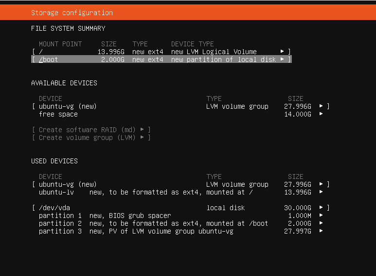
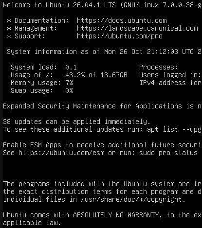

# Setting up my Ubuntu Server

For the Linux server I downloaded the latest Ubuntu Server (26.04.1).

I then opened up the KVM Virtual Machine Manager (virt-manager) from my terminal and added the new VM:

* **Memory:** 4096 MB
* **CPU:** 2 cores
* **Disk space:** 30 GB

## Installer

The VM booted up and I selected the **Try or Install Ubuntu Server** option.

* **Language and layout:** English (UK)
* **Type of install:** Ubuntu Server
* **Network:** The network interface was disabled by default. I selected the interface → **Edit IPv4** → **IPv4 Method: Automatic (DHCP)**. The IP address was then assigned automatically.
* **Proxy address:** Left blank, not needed for this use case.

### Storage Configuration

* **Use an entire disk:** the only disk option for the VM was auto-selected.
* **Set up this disk as an LVM group:** enabled, for a future use case where I may need to enlarge the disk. This would make it easier than with a plain partition.

!!! note "Half the disk is left unallocated after choosing LVM"
    After selecting this, roughly half of the disk is not given to the root volume by the installer and appears "lost". It can be recovered with:

    ```bash
    sudo lvextend -r -l +100%FREE /dev/ubuntu-vg/ubuntu-lv
    ```

* **LUKS encryption:** turned off. I did not want to be entering a passphrase every time I use the server in this simple homelab environment. In the real world, I would always have this enabled.

I then saw a final overview of my configuration before creation.



After I clicked Done, I was prompted to **Confirm destructive action**. This is because the drive is wiped and partitioned accordingly.

### Server Name, Login and Options

I then had to enter the name of the server and login details.

* **Ubuntu Pro:** I declined it, as it's not needed for my homelab use case.
* **OpenSSH server:** I enabled it, without any SSH keys imported.
* **Featured server snaps:** there was an option to install some of these for convenience, such as Docker and Nextcloud. I left all options unchecked, as anything I wish to install can be done later.

### Install and First Boot

The install screen then ran and took around 2 minutes to complete. I could then view the full log or reboot now, and I selected **Reboot Now**.

After a brief loading screen, due to the first official boot, I was prompted to enter my login credentials, and then I was online.



!!! success "Ubuntu Server installed and booting"
    The server installed cleanly, rebooted into the first boot, and I could log in at the console.

---

## Final Validation Summary

| Test | Result |
|---|---|
| Ubuntu Server 26.04.1 ISO downloaded | ✅ Done |
| VM created in virt-manager (4096 MB RAM, 2 cores, 30 GB disk) | ✅ Done |
| Network interface enabled with IPv4 DHCP, IP assigned automatically | ✅ YES |
| Storage set up as an LVM group, LUKS encryption left off (lab only) | ✅ Done |
| Ubuntu Pro declined, OpenSSH enabled, no featured snaps installed | ✅ Done |
| Installation completed (about 2 minutes) | ✅ YES |
| First boot and login at the console | ✅ YES |

---

## Key Takeaways

* **The Ubuntu Server ISO is its own installer**, a text-based one, with no desktop, so it suits a lightweight homelab VM.
* **The network interface can be disabled by default in the installer.** It needed editing to IPv4 DHCP before an address was assigned.
* **LVM leaves part of the disk unallocated by default.** It's easy to recover afterwards with `lvextend`, which is the main reason to choose LVM over a plain partition when I may need to grow the disk later.
* **LUKS encryption is a trade-off.** It was left off here to avoid entering a passphrase at every boot in a lab, but in a real environment it should always be on.
* **Anything skipped in the installer, such as Ubuntu Pro, SSH keys and snaps, can be added later**, so a minimal install is a sensible starting point.
